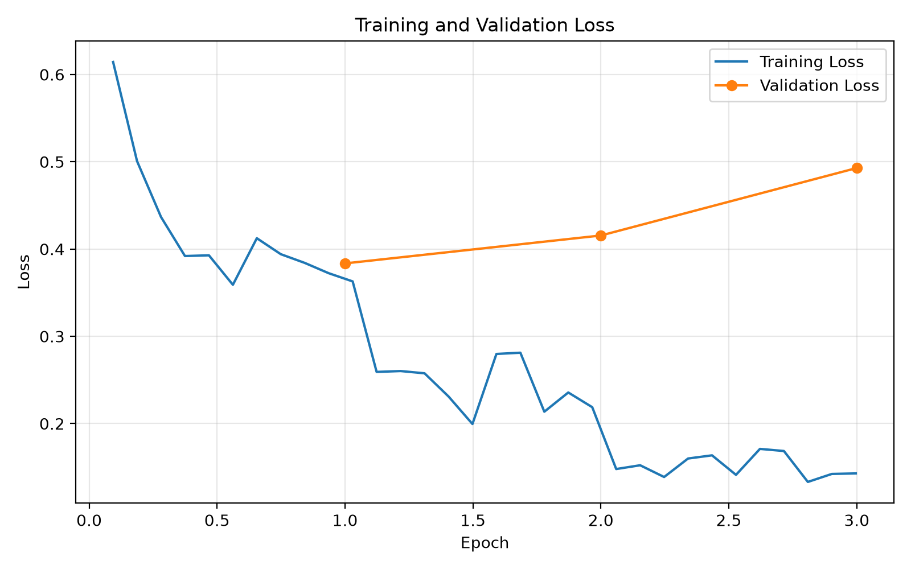
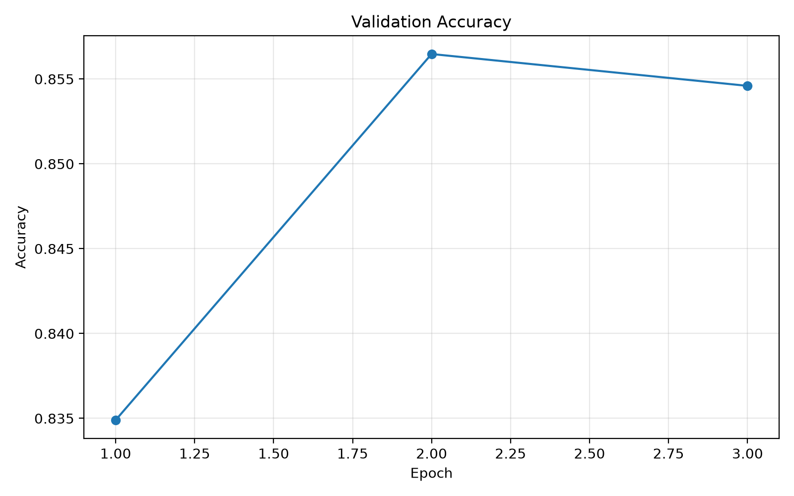
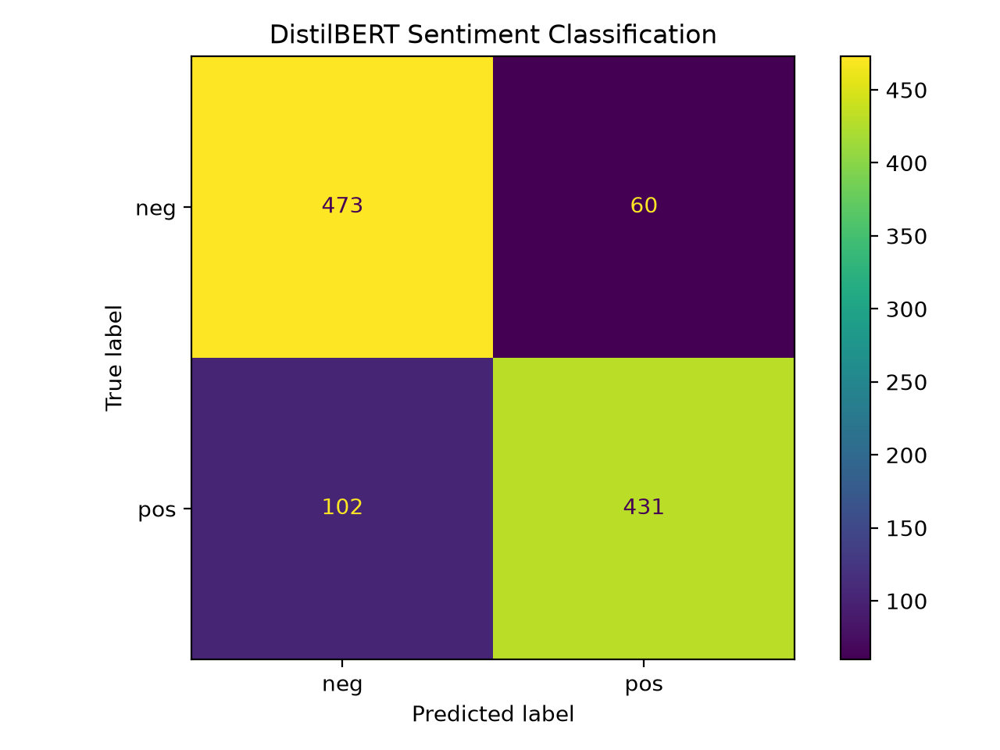

# DistilBERT Sentiment Classification

A binary sentiment classification project using DistilBERT fine-tuned on the Rotten Tomatoes movie review dataset.

## Features
- Pretrained DistilBERT model
- Hugging Face Transformers and Datasets
- Dynamic padding
- Fine-tuning with Trainer
- Accuracy evaluation
- Best checkpoint selection
- Inference on custom English text

## Model
- Base model: `distilbert-base-uncased`
- Dataset: `rotten_tomatoes`
- Task: Binary sentiment classification
- Classes: Negative, Positive

## Training Configuration
- Learning rate: 2e-5
- Batch size: 16
- Epochs: 3
- Weight decay: 0.01
- Max sequence length: 128
- Random seed: 59

## Training Results

### Training and Validation Loss

### Validation Accuracy

### Confusion Matrix

## Outputs
- `distilbert_sentiment_model/`: Training checkpoints
- `distilbert_sentiment_best/`: Best fine-tuned model
- `results/test_metrics.json`: Test evaluation metrics
